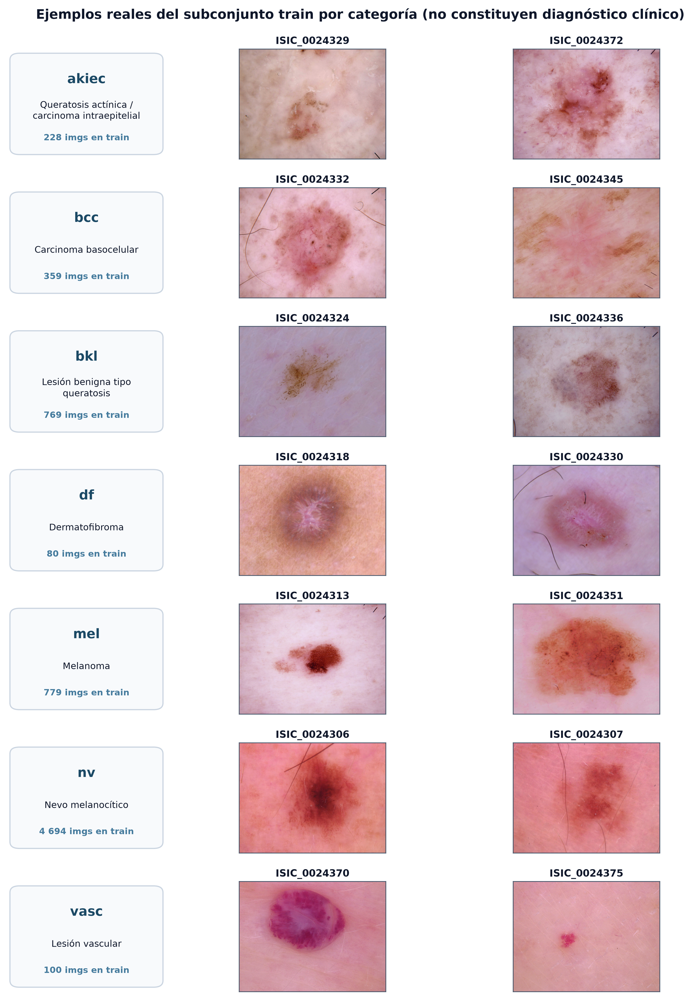
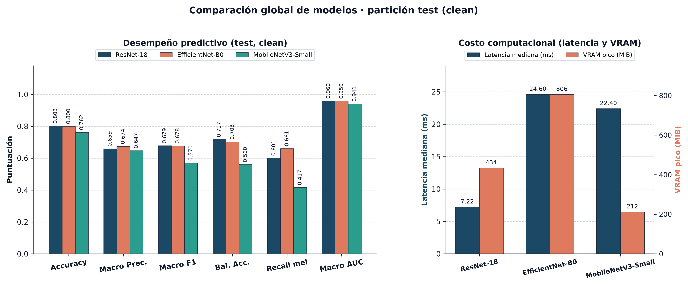
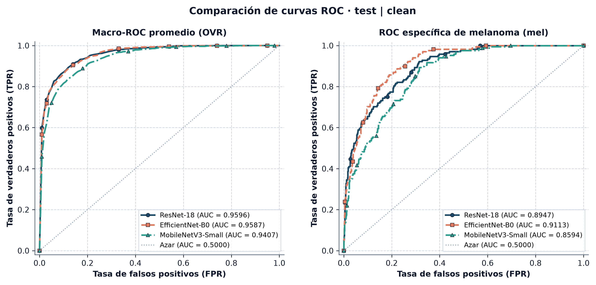
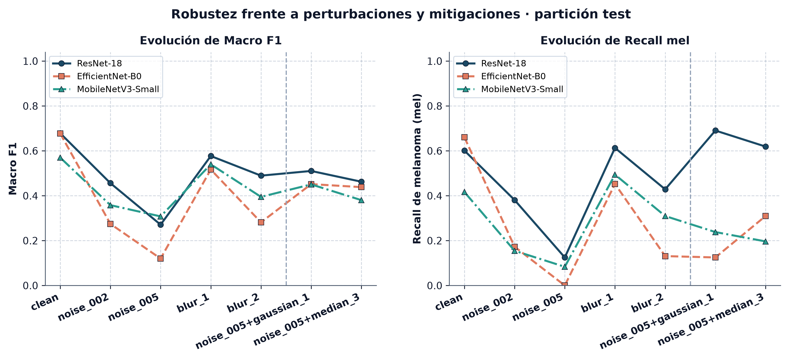

# Evaluación Comparativa de Tres Arquitecturas CNN para Clasificación de Lesiones Cutáneas Pigmentadas mediante Dermatoscopia (HAM10000)

[](https://www.python.org/)
[](https://pytorch.org/)
[](https://pytorch.org/)
[](https://developer.nvidia.com/cuda-zone)
[](proyecto_ham10000/latex/paper_ieee.pdf)
[](proyecto_ham10000/latex/main.pdf)
[](proyecto_ham10000/presentacion/presentacion_grupo09.pdf)
[](proyecto_ham10000/PLAN_TRABAJO.md)

**Universidad Nacional de San Antonio Abad del Cusco (UNSAAC)**  
Facultad de Ingeniería Eléctrica, Electrónica, Informática y Mecánica  
Escuela Profesional de Ingeniería Informática y de Sistemas  
**Asignatura:** Visión por Computador (Semestre Académico 2026-II)  
**Docente evaluador:** Mg. Hans Harley Ccacyahuillca Bejar  

---

### Autores / Integrantes del Grupo N.º 9

| N.º | Integrante | Código Institucional | Correo Institucional |
|:---:|---|:---:|:---:|
| 1 | **Choquenaira Quispe, Noe Franklin** | `133962` | `133962@unsaac.edu.pe` |
| 2 | **Porroa Sivana, Yeni Ruth** | `120893` | `120893@unsaac.edu.pe` |
| 3 | **Colque Galindo, Jean Franco** | `193109` | `193109@unsaac.edu.pe` |

---

## 1. Resumen Ejecutivo de la Investigación

Este proyecto implementa y documenta un estudio experimental riguroso y reproducible que compara tres familias convolucionales compactas mediante transferencia de aprendizaje sobre el benchmark internacional **HAM10000** (*Human Against Machine with 10,000 training images*, Tschandl et al., *Scientific Data* 2018):

1. **ResNet-18** (bloques residuales estándar $3\times 3$, 11.18 M parámetros).
2. **EfficientNet-B0** (escalado compuesto MBConv con atención Squeeze-and-Excitation, 4.02 M parámetros).
3. **MobileNetV3-Small** (convoluciones separables en profundidad y activaciones *hard-swish*, 1.53 M parámetros).

### Principales retos metodológicos abordados:
- **Desbalance extremo (58.3 : 1):** la clase mayoritaria `nv` (nevus melanocítico) concentra el **66.95%** (6 705 imágenes), mientras `df` (dermatofibroma) representa apenas el **1.15%** (115 imágenes).
- **Control estricto de fuga de datos (*data leakage*):** las 10 015 imágenes corresponden a 7 470 lesiones únicas con múltiples tomas por paciente. Se diseñó una partición agrupada mediante `StratifiedGroupKFold(K=20)` con semilla fija 42 (`7009 train` / `1503 val` / `1503 test`), garantizando **0 cruces de lesión, grupo o duplicados SHA-256** entre particiones (`split_sha256: 583779fb...`).
- **Evaluación multimétrica real en GPU común:** entrenamiento homogéneo en precisión FP32 sobre **GPU NVIDIA GeForce GTX 1650 (4 GiB VRAM)**, contrastando precisión, sensibilidad, macro F1, exactitud balanceada, AUC OVR, estabilidad frente a ruido aditivo y desenfoque, mitigación espacial mediante filtrado determinista y latencia de inferencia `batch=1`.
- **Alcance formal:** investigación científica y académica; el despliegue interactivo (web o móvil) quedó **explícitamente excluido** del alcance por indicación docente.

---

## 2. Resumen de Resultados Experimentales Auditados

Todos los experimentos fueron ejecutados íntegramente en hardware local verificado (**Acer Nitro AN515-45, AMD Ryzen 5 5600H, NVIDIA GTX 1650 4 GiB, driver 621.01, PyTorch 2.11.0+cu128, lote 8, semilla 42, FP32**).

### A. Desempeño en el conjunto `test` limpio ($n = 1\,503$)

| Arquitectura | Accuracy | **Macro Prec.** | Macro F1 | Bal. Acc. | Recall `mel` | AUC OVR | Tiempo/época | Latencia GPU (`batch=1`) | VRAM pico |
|---|:---:|:---:|:---:|:---:|:---:|:---:|:---:|:---:|:---:|
| **ResNet-18** | **0.8031** | 0.6591 | **0.6786** | **0.7174** | 0.6012 | **0.9596** | **127.5 s** | **7.22 ms** *(6.86–9.46)* | 434.2 MiB |
| **EfficientNet-B0** | 0.8004 | **0.6741** | 0.6778 | 0.7025 | **0.6607** | 0.9587 | 188.6 s | 24.60 ms *(22.49–34.82)* | 805.7 MiB |
| **MobileNetV3-Small** | 0.7625 | 0.6474 | 0.5700 | 0.5604 | 0.4167 | 0.9407 | 156.3 s | 22.40 ms *(15.26–22.40)* | **211.8 MiB** |

> **Nota sobre latencia:** mide exclusivamente el paso `forward()` en GPU FP32 con `batch=1` (10 warmup + 50 mediciones sincronizadas con CUDA), sin lectura E/S ni preprocesamiento en CPU.

### B. Análisis comparativo de Precisión (Precision) vs. Exactitud (Accuracy)
- **Líder en Precisión Macro:** **EfficientNet-B0 lidera con 67.41%** (frente a 65.91% de ResNet-18 y 64.74% de MobileNetV3-Small), destacando en queratosis actínica (`akiec`: **85.71%**) y nevus (`nv`: **92.97%**), al cometer menor cantidad de falsas alarmas.
- **Líder en Balance Global y Eficiencia:** **ResNet-18** logra el mejor equilibrio operativo: lidera en **Exactitud global (80.31%)**, **Macro F1 (0.6786)**, **Exactitud balanceada (0.7174)** y **AUC OVR (0.9596)**, requiriendo **3.4× menor latencia en GPU (7.22 ms)** que EfficientNet-B0 (24.60 ms).
- **Rigor estadístico:** La diferencia puntual de apenas $\Delta = 0.00084$ en Macro F1 entre ResNet-18 y EfficientNet-B0 **no demuestra superioridad estadística ni equivalencia** (análisis *bootstrap* pareado por 1 118 grupos independientes en `test`: IC 95% `[-0.0429, +0.0464]`).

### C. Robustez frente a perturbaciones y mitigación espacial en `test` (Macro F1)

| Condición evaluada | Parámetro | ResNet-18 | EfficientNet-B0 | MobileNetV3-Small |
|---|---|:---:|:---:|:---:|
| **Referencia limpia (`clean`)** | $\sigma = 0$ | **0.6786** | 0.6778 | 0.5700 |
| **Ruido gaussiano (`noise_002`)** | $\sigma = 0.02$ | **0.4561** | 0.2745 | 0.3580 |
| **Ruido severo (`noise_005`)** | $\sigma = 0.05$ | 0.2710 | 0.1201 *(Rec. mel: 0.00)* | **0.3079** |
| **Desenfoque moderado (`blur_1`)** | radio = 1 px | **0.5769** | 0.5167 | 0.5398 |
| **Desenfoque severo (`blur_2`)** | radio = 2 px | **0.4895** | 0.2815 | 0.3949 |
| **Mitigación Mediana (`+median_3`)** | $3\times 3$ sobre `n005` | **0.4624** *(Rec. mel: 0.619)* | 0.4383 *(Rec. mel: 0.310)* | 0.3804 |
| **Mitigación Gaussiana (`+gaussian_1`)** | $r=1.0$ sobre `n005` | **0.5104** *(Rec. mel: **0.691**)* | 0.4518 *(Rec. mel: 0.125)* | 0.4505 |

> **Hallazgo crítico de mitigación:** El filtro `gaussian_1` recupera entre **+0.14 y +0.33** puntos de Macro F1 sobre `noise_005` sin reentrenar. Sin embargo, constituye una **mitigación parcial** sujeta a un compromiso operativo: en ResNet-18, aunque el Recall de melanoma sube de `0.6012` a `0.6905`, la **Precision en melanoma desciende de `0.5233` a `0.3648`**, duplicando los falsos positivos de **92 a 202**.

---

## 3. Entregables Principales del Proyecto

| Entregable | Archivo principal | Descripción técnica |
|---|---|---|
| **Informe Técnico Ampliado** | [`proyecto_ham10000/latex/main.pdf`](proyecto_ham10000/latex/main.pdf) | **50 páginas**, tipografía Latin Modern 10 pt, texto y tablas monocromáticas, figuras en color a 300 DPI, 0 advertencias y 0 desbordes. Incluye marco teórico, auditoría criptográfica, fundamentación matemática, desglose por clase, análisis de latencia y código. |
| **Artículo Científico IEEE** | [`proyecto_ham10000/latex/paper_ieee.pdf`](proyecto_ham10000/latex/paper_ieee.pdf) | **8 páginas**, formato oficial `IEEEtran` de 2 columnas, resumen formal, ecuaciones normalizadas de pérdida ponderada, cuadros de resultados y 19 referencias indexadas. |
| **Presentación Oral de Defensa** | [`proyecto_ham10000/presentacion/presentacion_grupo09.pdf`](proyecto_ham10000/presentacion/presentacion_grupo09.pdf) | **11 diapositivas** en formato panorámico 16:9 con paleta institucional UNSAAC, tabla comparativa con columna de precisión destacada y mosaico de las 7 clases clínicas reales. |
| **Guion Cronometrado (10 min)** | [`proyecto_ham10000/presentacion/guion_exposicion_10min.md`](proyecto_ham10000/presentacion/guion_exposicion_10min.md) | **1 032 palabras habladas**, distribución equitativa de 3 min 20 s por integrante (Noe: Diaps. 1–4; Yeni: Diaps. 5–8; Jean Franco: Diaps. 9–11) y banco de 5 preguntas frecuentes. |
| **Cuaderno Integrado (Jupyter / Colab)** | [`proyecto_ham10000/colab/HAM10000_Grupo09.ipynb`](proyecto_ham10000/colab/HAM10000_Grupo09.ipynb) | **22 celdas**, ejecución dual local (VS Code sin `ModuleNotFoundError`) y Google Colab; invoca el paquete común `ham10000`, valida los 10 015 originales y mantiene controles seguros. |
| **Paquete Portable Distribuible** | `proyecto_ham10000_colab.zip` | ZIP limpio generado mediante `empaquetar.py` (**44.3 MiB**, CRC verificado), que excluye imágenes pesadas y checkpoints pero incluye fuentes, tablas, gráficos 300 DPI y entregables PDF. |

---

## 4. Evidencia Visual del Estudio

<p align="center">
  <br>
  <em>Figura 1: Muestras representativas de las 7 categorías diagnósticas de HAM10000 tomadas exclusivamente de entrenamiento.</em>
</p>

<p align="center">
  <br>
  <em>Figura 2: Comparación multimétrica en test limpio (izquierda, con precisión destacada) y costo computacional en GPU (derecha).</em>
</p>

<p align="center">
  <br>
  <em>Figura 3: Curvas ROC OVR macro-promedio (izquierda) y específicas de melanoma (derecha).</em>
</p>

<p align="center">
  <br>
  <em>Figura 4: Degradación ante ruido gaussiano / desenfoque y recuperación parcial mediante mitigación espacial (+median_3 / +gaussian_1).</em>
</p>

---

## 5. Estructura del Repositorio

```text
.
├── .gitignore                          # Exclusiones de Git (venv, imágenes pesadas, checkpoints .pt, temporales)
├── README.md                           # Presentación general y documentación del repositorio en GitHub
├── README_ENTORNO_GPU.md               # Diagnóstico de GPU local, drivers y verificación de CUDA
├── requirements-cuda.txt               # PyTorch 2.11.0+cu128 y torchvision 0.26.0+cu128
├── verificar_gpu.py                    # Script de verificación rápida de CUDA y memoria en PyTorch
│
├── descargaDataSet/                    # Módulo de ingesta y descarga
│   ├── descargar.py                    # Descargador reproducible con reanudación y verificación SHA-256
│   ├── limpiar_zip.py                  # Extracción segura contra colisiones de rutas
│   ├── test_descargar.py               # 4 pruebas automáticas del descargador
│   └── README.md                       # Instrucciones de descarga del conjunto original
│
└── proyecto_ham10000/                  # Proyecto principal de investigación
    ├── PLAN_TRABAJO.md                 # Registro de fases completadas y matriz de aceptación
    ├── README.md                       # Documentación técnica interna
    ├── configs/
    │   └── base.json                   # Protocolo experimental frozen (batch 8, FP32, seed 42, workers 4)
    ├── data/
    │   └── processed/
    │       ├── split.csv               # Manifiesto fijo libre de fugas (7009 train / 1503 val / 1503 test)
    │       ├── dataset_procesado.csv   # Mapeo de rutas procesadas
    │       ├── estadisticas.json       # Momentos RGB de train y pesos de clase calculados
    │       └── auditoria.json          # Auditoría de 10 015 imágenes y 7 470 lesiones únicas
    ├── python/
    │   ├── ejecutar.py                 # CLI unificada (preparar, validar, exportar, entrenar, evaluar, comparar)
    │   ├── requirements-common.txt     # Dependencias comunes (NumPy, Pillow, scikit-learn, matplotlib)
    │   ├── requirements-cuda.txt       # Requisitos específicos CUDA locales
    │   ├── requirements-notebook.txt   # Requisitos opcionales para Jupyter y validación
    │   ├── ham10000/                   # Paquete modular común
    │   │   ├── __init__.py             # Definición canónica de CLASES (7) y MODELOS (3)
    │   │   ├── io.py                   # Lectura UTF-8 BOM-safe, guardado atómico y sha256
    │   │   ├── data.py                 # Letterbox isotrópico 224x224, aumentos deterministas y filtros
    │   │   ├── models.py               # Construcción de ResNet-18, EfficientNet-B0 y MobileNetV3-Small
    │   │   ├── engine.py               # Ciclo de entrenamiento de 2 etapas, checkpoints y evaluación
    │   │   ├── metrics.py              # Cálculo exacto de Macro Precision, F1, Bal Acc, AUC OVR y matriz
    │   │   ├── artifacts.py            # Verificación de integridad de evaluaciones persistidas
    │   │   └── plots.py                # Generación de 11 figuras descriptivas, curvas ROC y comparativas
    │   └── tests/                      # Suite de 22 pruebas automáticas unitarias y de integración
    ├── colab/
    │   ├── HAM10000_Grupo09.ipynb      # Cuaderno Jupyter/Colab integrado de 22 celdas
    │   ├── README_COLAB.md             # Guía paso a paso para uso local y en Google Colab
    │   ├── runtime.py                  # Detección de entorno alojado y descompresión segura
    │   ├── generar_notebook.py         # Generador determinista del cuaderno a partir de código
    │   ├── verificar_notebook.py       # Validador de esquema nbformat y ejecutor de pruebas del notebook
    │   └── empaquetar.py               # Generador del archivo distribuible proyecto_ham10000_colab.zip
    ├── resultados/                     # 24 evaluaciones reales consolidadas
    │   ├── comparacion.csv             # Tabla maestra con métricas de las 24 evaluaciones
    │   └── *.png                       # Matrices de confusión, curvas ROC OVR y comparativas (62 figuras)
    ├── latex/
    │   ├── main.tex                    # Código fuente del Informe Técnico Ampliado (50 págs.)
    │   ├── paper_ieee.tex              # Código fuente del Artículo Científico IEEE (8 págs.)
    │   ├── referencias.bib             # 19 referencias bibliográficas canónicas
    │   ├── secciones/                  # 18 secciones modulares en LaTeX
    │   ├── tablas/                     # Tablas generadas automáticamente
    │   ├── img/                        # Figuras en alta resolución a 300 DPI y escudo institucional
    │   ├── main.pdf                    # PDF compilado del informe técnico (50 págs.)
    │   ├── paper_ieee.pdf              # PDF compilado del artículo IEEE (8 págs.)
    │   └── compilar.py                 # Script de compilación automática con verificación de páginas
    └── presentacion/
        ├── presentacion_grupo09.tex    # Diapositivas en Beamer (11 láminas, 16:9)
        ├── presentacion_grupo09.pdf    # PDF compilado de la presentación
        └── guion_exposicion_10min.md   # Guion oral de 10 minutos cronometrado (1 032 palabras)
```

---

## 6. Guía Rápida de Reproducción

### Requisitos previos
- Windows 10/11 o Linux con Python 3.12+.
- Tarjeta gráfica NVIDIA (recomendado $\ge$ 4 GiB VRAM para reproducir tiempos y memorias).
- MiKTeX o TeX Live si se desea compilar los documentos LaTeX localmente.

### Paso 1: Clonar el repositorio
```bash
git clone https://github.com/frankich99/DATASET-Skin-Cancer-ISIC-Vision-Comp.git
cd DATASET-Skin-Cancer-ISIC-Vision-Comp
```

### Paso 2: Crear el entorno virtual e instalar dependencias
```powershell
python -m venv .venv
.\.venv\Scripts\Activate.ps1
pip install -r requirements-cuda.txt
pip install -r proyecto_ham10000/python/requirements-common.txt
pip install -r proyecto_ham10000/python/requirements-notebook.txt
```

### Paso 3: Ejecutar la suite completa de pruebas automáticas (26 pruebas)
```powershell
# 22 pruebas del pipeline, modelos, artefactos y notebook
$env:PYTHONPATH = "$PWD\proyecto_ham10000\python"
.\.venv\Scripts\python.exe -m unittest discover -s proyecto_ham10000/python/tests -v

# 4 pruebas de descarga y validación
.\.venv\Scripts\python.exe -m unittest discover -s descargaDataSet -p "test_descargar.py" -v
```

### Paso 4: Validar el dataset frente al split fijo
```powershell
.\.venv\Scripts\python.exe proyecto_ham10000/python/ejecutar.py validar `
  --datos descargaDataSet/HAM10000 `
  --split proyecto_ham10000/data/processed/split.csv
```

### Paso 5: Compilar los documentos LaTeX (Informe y Artículo)
```powershell
cd proyecto_ham10000/latex
..\..\.venv\Scripts\python.exe compilar.py
cd ../..
```

---

## 7. Responsabilidad Académica y Uso Responsable

- **Propósito académico:** Este repositorio fue desarrollado con fines exclusivamente académicos para la asignatura de **Visión por Computador (2026-II)** de la **UNSAAC**.
- **No es una herramienta de diagnóstico clínico:** Las predicciones, probabilidades y métricas reportadas no deben utilizarse como sustituto del juicio clínico ni para la toma de decisiones médicas en pacientes reales.
- **Licencia de datos:** El conjunto de datos HAM10000 pertenece a sus respectivos autores (*Tschandl et al., Scientific Data, 2018; International Skin Imaging Collaboration*). Este repositorio no redistribuye las imágenes originales sin procesar.
